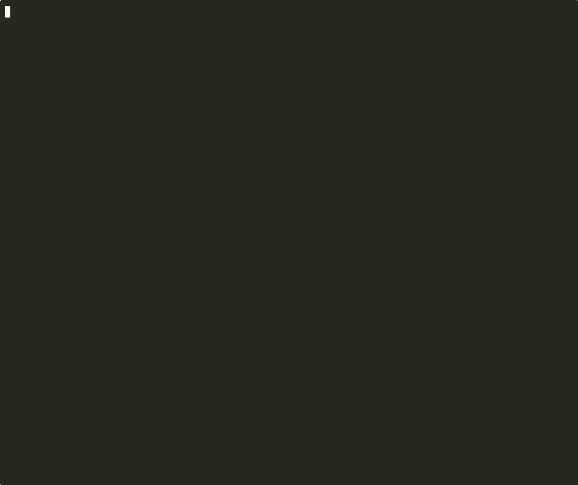

<div align="center">

# php2shell-ioc

**Were you hit by PHP2Shell? A read-only triage script that finds out.**

Indicator-of-compromise checks for **CVE-2026-109618** and **CVE-2026-109619**,<br>
the October 2026 PHP remote-code-execution vulnerabilities.

[](https://github.com/ericmann/php2shell-ioc/actions/workflows/ci.yml)
[](https://github.com/ericmann/php2shell-ioc/releases/tag/v1.0.0)
[](LICENSE)
[](docs/design.md#one-posix-sh-file)
[](.github/workflows/ci.yml)
[](docs/design.md#read-only-provably)
[](docs/design.md#no-network)

WordPress · Nextcloud · Laravel · Drupal · plain PHP<br>
bare metal · VMs · Docker · Kubernetes · BusyBox, dash, bash

[Quick start](#quick-start) · [Demo](#see-it-work) · [What it checks](#what-it-checks) · [Indicators](docs/indicators.md) · [Running it](docs/running.md) · [Design](docs/design.md)

<p align="center">
  
</p>

</div>

---

One POSIX `sh` file. Stream it into a running container or pod; nothing gets
copied or installed:

```console
$ docker exec -i -u 0 my-wordpress sh -s < php2shell-ioc.sh
```

> **Patch first.** If you are not yet on PHP 8.5.12, 8.4.27, 8.3.36 or 8.2.35
> (or a distro package carrying the backport), stop reading and update. This tool
> answers a different question: *now that we're patched, were we hit?*

## What it promises

- **Read-only.** It never creates, modifies or deletes a file, not even a temp
  file. The test suite proves this by checksumming the whole filesystem before
  and after a full run.
- **No network.** It opens no connections except to a Redis server you name with
  `--redis`. The test suite runs every case with `--network none`.
- **Never runs your application's code.** If the app was backdoored, running
  `wp`, `occ` or `artisan` is exactly what an attacker wants. The script prints
  those commands for you to run deliberately instead.
- **Never prints secrets.** No session contents, environment variables, SSH key
  material or config values (beyond a fixed list of PHP ini settings). It does
  print file paths, log lines (which contain IPs and URLs) and process command
  lines, so review the output before pasting it anywhere public.

## Quick start

Read the script first. It's commented throughout, and you are about to run it
on a server, possibly as root.

```sh
# Fetch a specific release and verify it (see "Verifying a download" below)
curl -fsSLO https://github.com/ericmann/php2shell-ioc/releases/download/v1.0.0/php2shell-ioc.sh

# On a host
sudo sh php2shell-ioc.sh

# Inside a Docker container (as root inside the container, to read everything)
docker exec -i -u 0 CONTAINER sh -s < php2shell-ioc.sh

# Inside a Kubernetes pod
kubectl exec -i deploy/web -- sh -s < php2shell-ioc.sh

# Container logs live outside the container; pipe them in
docker logs CONTAINER 2>&1 | sh php2shell-ioc.sh --only logs --log -

# PHP sessions in Redis: run the sessions check where redis-cli exists
docker exec -i REDIS_CONTAINER sh -s -- --only sessions --redis 127.0.0.1:6379 < php2shell-ioc.sh
```

More recipes, including Docker Compose, rotated logs and checking your CDN's
edge analytics when container logs are gone, are in [docs/running.md](docs/running.md).

## See it work

```sh
make demo        # or: sh demo/run.sh
```

(The animation at the top is this demo. To replay the recording in your
terminal: `asciinema play docs/demo.cast`. To re-record it: `make cast`.)

This starts a throwaway Alpine container with no network, scans a clean
WordPress-shaped site, then plants harmless stand-ins for each indicator
([demo/plant.sh](demo/plant.sh)) and scans again. Nothing on your machine is
touched, and nothing in the demo exploits anything.

An excerpt of the planted scan:

```text
== 2. Logs ==
  [FLAG] /var/log/nginx/error.log: 1 out-of-memory fatal(s) 'in Unknown on line 0' (died while parsing the request)
         [20-Oct-2026 21:14:01] PHP Fatal error:  Allowed memory size of 134217728 bytes exhausted (tried to allocate 20480 bytes) in Unknown on line 0
  [FLAG] /var/log/nginx/error.log: 1 worker crash / heap-corruption line(s)
         [20-Oct-2026 21:14:02] WARNING: [pool www] child 41 exited on signal 11 (SIGSEGV) after 12.3 seconds from start

== 3. Sessions ==
  [FLAG] /var/lib/php/sessions: 1 of 2 session file(s) contain upload_progress_ data

== 4. Files ==
  /var/www/html (wordpress)
  [FLAG] executable PHP in a data/upload location (/var/www/html/wp-content/uploads):
         /var/www/html/wp-content/uploads/2026/10/thumb.php
  [FLAG] auto_prepend/append_file set in a per-directory config (classic persistence):
         /var/www/html/.user.ini:1:auto_prepend_file=/tmp/.demo.php

== Verdict ==
  6 flag(s), 8 warning(s).
```

## What it checks

| Section | Looks for | Strongest signal |
|---|---|---|
| **1. runtime** | PHP version per binary (CLI, FPM, FrankenPHP) vs. the patched releases; `upload_progress`, `display_errors` and related ini settings | an unpatched or end-of-life build |
| **2. logs** | Error and access logs (files, `.gz`, or stdin), combined or JSON | `Allowed memory size … in Unknown on line 0`; worker crashes |
| **3. sessions** | File sessions and, with `--redis`, Redis sessions | `upload_progress_` data on a site that never shows upload progress |
| **4. files** | PHP in upload/data folders, `.user.ini`/`.htaccess` tricks, web-shell patterns, hidden or double-extension PHP, recent changes, `git status` | PHP in uploads; `auto_prepend_file` |
| **5. system** | Processes as the web user, network connections, cron/SSH/account changes, `ld.so.preload`, temp-dir executables | a shell running as `www-data` |

Every indicator, why it matters, and how to tell it from noise, is in
[docs/indicators.md](docs/indicators.md).

## Reading the output

```text
  [FLAG] strong indicator: investigate
  [warn] worth a look; often benign (the message says when)
  [ ok ] a check passed
  [info] context
```

| Exit code | Meaning |
|---|---|
| `0` | no flags or warnings |
| `1` | warnings only |
| `2` | at least one flag |
| `64` | usage error |

A typical clean run on a patched, recently redeployed container ends with one
or two `[warn]`s you can explain: `/etc/passwd` changed when the image was
built, or a framework's cron container legitimately has a crontab.

**If you get a FLAG:** don't panic, and don't "clean up" yet. Preserve logs
and the suspicious files, take the service off the internet if you can, and
work through [docs/indicators.md](docs/indicators.md). Patching does not undo
a compromise. If it's real, rotate every secret the PHP workers could read:
app keys, database and API credentials, session secrets, TLS keys.

## Options

```text
--root DIR          application root to inspect (repeatable; default: auto-detect)
--log FILE|-        log file to scan, .gz ok, '-' = stdin (repeatable; default: auto-detect)
--session-dir DIR   PHP session directory (repeatable; default: from php.ini + usual paths)
--redis HOST:PORT   also scan PHP sessions stored in Redis (needs redis-cli)
--since YYYY-MM-DD  window start for "recently modified" checks (default 2026-10-01)
--only LIST         sections: runtime,logs,sessions,files,system
--max-samples N     sample lines per finding (default 5)
--no-color          plain output
-V, --version       print version
-h, --help          usage
```

## Limitations

This is triage, not forensics:

- **Memory disclosure leaves almost no trace.** One variant leaks other
  requests' data back to the attacker without writing anything. A clean result
  can't rule that out.
- **Redeployed containers have no history.** If you rebuilt after patching,
  the old logs, `/tmp` and file sessions are gone. Scan persistent volumes, and
  check your edge or CDN analytics, which outlive the containers.
- **Behind a proxy, access logs show the proxy's IP** unless you've configured
  real-IP handling.
- **An attacker with root can hide from any on-host check.** If you have reason
  to believe that happened, image the disk and investigate offline.
- **Heuristics have false positives.** Vendored libraries occasionally match a
  web-shell pattern; read each hit before you conclude anything.

## Verifying a download

Each release attaches the script and its SHA-256, and the tag and commits are
GPG-signed. Check the checksum before you run it:

```sh
curl -fsSLO https://github.com/ericmann/php2shell-ioc/releases/download/v1.0.0/php2shell-ioc.sh
curl -fsSLO https://github.com/ericmann/php2shell-ioc/releases/download/v1.0.0/php2shell-ioc.sh.sha256
sha256sum -c php2shell-ioc.sh.sha256
```

Pin to a release, not to `main`.

## Development

```sh
make lint    # shellcheck, POSIX sh
make test    # test matrix in Docker: BusyBox ash, dash, bash, real PHP, Redis, git
make check   # both (what CI runs)
make demo    # the demo
make cast    # re-record docs/demo.cast and render docs/demo.gif (needs agg)
```

Releases are cut by pushing a signed `vX.Y.Z` tag; the release workflow checks
the tag against `VERSION`, re-runs everything, and publishes the script with its
checksum. See [CONTRIBUTING.md](CONTRIBUTING.md#releasing).

The tests plant indicators in disposable containers and assert on the output.
They also prove the safety properties: the read-only checksum, `--network none`,
a booby-trapped `.git/config` that must not fire, and Docker-style log symlinks
to `/dev/stdout` that must not hang. See [CONTRIBUTING.md](CONTRIBUTING.md) and
[docs/design.md](docs/design.md).

## Background

- PHP Foundation, *Today's PHP security release and how we're strengthening PHP
  security* (2026-10-21):
  https://thephp.foundation/blog/2026/10/21/todays-php-security-release-and-how-were-strengthening-php-security/
- PHP2Shell research summary (Wiz Research, OpenAI Codex Security, Calif):
  https://www.php2shell.com/

## License

MIT. See [LICENSE](LICENSE).
